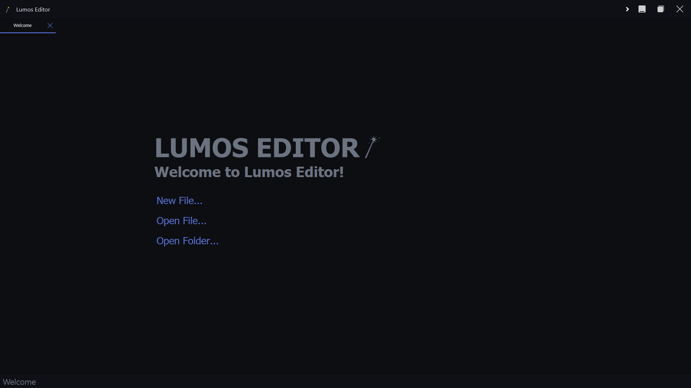
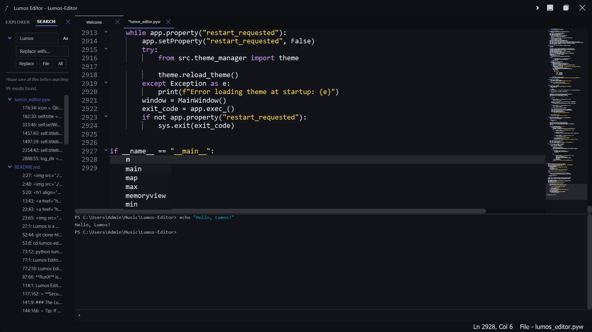

<p align="center">
  
</p>

<h1 align="center">Lumos Editor</h1>

<p align="center">
  A modern, extensible code editor built with Python and PyQt5.
</p>

<p align="center">
  <a href="https://opensource.org/licenses/MIT">
    
  </a>
  <a href="https://github.com/memeviber/lumos-editor/releases">
    
  </a>
  <a href="https://www.python.org/">
    
  </a>
  <a href="https://riverbankcomputing.com/software/pyqt/">
    
  </a>
  <a href="https://github.com/memeviber/lumos-editor/stargazers">
    
  </a>
</p>

Lumos Editor is a desktop code editor designed to bring essential development tools into a single, customizable workspace. Built with Python and PyQt5, it combines syntax highlighting, project navigation, Git integration, an integrated terminal, Markdown preview, and a flexible plugin system.

Whether you're editing source code, managing a project, or extending the editor with your own plugins, Lumos provides a foundation you can adapt to your workflow.

## Screenshots

<p align="center">
  
</p>

<p align="center">
  
</p>

## Features

### Editing and Navigation

- **Syntax Highlighting:** Syntax highlighting with support for custom language lexers.
- **Advanced File Explorer:** Browse projects and create, rename, delete, copy, cut, paste, or move files through drag-and-drop operations.
- **Multi-Tab Editing:** Open multiple files simultaneously with movable and closable tabs.
- **Search and Replace:** Find and replace text within the current file or across the entire project.
- **Markdown Preview:** Preview Markdown documents, including embedded images and syntax-highlighted code blocks.

### Development Tools

- **Source Control Integration:** Manage Git repositories through a dedicated source control panel.
- **Integrated Terminal:** Execute shell commands without leaving the editor.
- **AI Chat Assistant:** Get coding assistance, generate code, and ask programming questions through an integrated Gemini-powered chat assistant.
- **RunX File Runner:** Run supported files in the integrated terminal or open HTML documents in your default browser.
- **Media Viewer:** Open common image, audio, and video formats directly in the editor.

### Customization and Extensibility

- **Plugin System:** Extend editor functionality with custom language lexers, menu actions, and event hooks.
- **Custom Themes:** Choose from built-in themes or create your own color schemes using JSON files.
- **PyFlex Lexer:** Use the default fast Python lexer for a more responsive editing experience, particularly when working with large Python files.

## Supported Platforms

Lumos Editor currently supports:

- **Windows**
- **Linux**

macOS has not been tested or optimized and is not officially supported. Some features may not work as expected.

### Interactive Window Resizing

Drag any window edge or corner to resize it; the mouse cursor indicates the resize direction. You can also use the size grip in the bottom-right corner of the status bar.

While the window is being resized or changing size through snap/maximize shortcuts, the editor temporarily pauses content rendering and displays an overlay. During a drag, the overlay hides the border and drop shadow; when snapping to half the screen, the border remains square and the shadow stays hidden. The full interface is rendered again when the transition ends. This avoids border, shadow, and menu-bar flicker.

The menu bar is normally hidden behind the arrow icon in the top-right corner of the title bar.

Use **Alt + Left/Right Arrow** to place the editor on either half of the active monitor, **Alt + Up Arrow** to maximize, and **Alt + Down Arrow** to restore it. Windows reserves the **Windows + Arrow** shortcuts for native window snapping, which is not supported by this custom frameless window.

### Why Lumos Uses a Custom Frameless Window

Lumos builds its frameless window from PyQt5 widgets instead of using a package such as [**PyQt5-Frameless-Window**](https://pypi.org/project/PyQt5-Frameless-Window/). This gives the editor direct control over how its custom title bar, resize handles, border, shadow, snap shortcuts, and transition overlay work together with the rest of the interface and its themes. It also avoids adding a separate window-management dependency. PyPI classifies that package as GPLv3, while Lumos is distributed under the MIT License; avoiding the dependency keeps third-party license obligations clearer when distributing Lumos and helps preserve the project's MIT licensing.

The trade-off is that Lumos must maintain these window behaviors itself. In particular, its custom frame does not receive Windows' native **Windows + Arrow** snapping behavior; use the documented **Alt + Arrow** shortcuts instead. Using a GPL-licensed dependency would not automatically change Lumos's license, but its terms and compatibility would need careful review before distribution.

## Installation

### Requirements

- Python 3.x
- Windows or Linux
- The dependencies listed in `requirements.txt`

The minimum supported Python version has not been specified. If you encounter compatibility issues, verify that your Python version is supported by the project's dependencies.

### 1. Clone the Repository

```bash
git clone https://github.com/memeviber/lumos-editor.git
cd lumos-editor
```

### 2. Create a Virtual Environment (Recommended)

Using a virtual environment helps keep Lumos dependencies separate from other Python projects.

**Windows — PowerShell**

```powershell
python -m venv .venv
.venv\Scripts\Activate.ps1
```

**Linux**

```bash
python3 -m venv .venv
source .venv/bin/activate
```

### 3. Install Dependencies

```bash
python -m pip install -r requirements.txt
```

### 4. Run Lumos Editor

```bash
python lumos_editor.pyw
```

If the application fails to start, check the error output and verify that the required Python dependencies are installed correctly.

## Configuration

Lumos supports customizable themes and configurable plugin behavior.

### Custom Themes

To add a custom theme:

1. Create a theme directory under `themes/`.
2. Add your theme configuration as a JSON file.
3. Follow the structure and naming conventions used by the existing themes.

Example directory structure:

```text
lumos-editor/
├── themes/
│   └── your-theme/
│       └── theme.json
└── lumos_editor.pyw
```

The exact theme schema should follow the existing theme implementations in the repository.

### PyFlex — Python Fast Lexer

PyFlex is enabled by default to improve editing responsiveness, especially in large Python files.

If you prefer richer syntax highlighting for smaller files, you can disable PyFlex and use the Pygments Python lexer instead.

Pygments may be slower on files larger than approximately 2,500 lines of code (LOC).

This threshold is a practical guideline rather than a universal performance limit. Actual performance depends on file structure, hardware, and other factors.

## RunX — File Runner Plugin

RunX is a lightweight, cross-platform file runner plugin for Lumos Editor.

It allows you to run the active file in the integrated terminal or open supported documents in your default system browser.

### Configuration

Configure RunX by creating a `runner_commands.json` file in the application root directory.

Example configuration:

```json
{
    ".py": "{python} {filepath_q} {args}",
    ".js": "node {filepath_q} {args}",
    ".sh": "bash {filepath_q} {args}"
}
```

Each key represents a file extension, and its value defines the command template used to execute files with that extension.

### Available Variables

| Variable | Description |
|---|---|
| `{filepath}` | Absolute path of the active file. |
| `{filepath_q}` | Quoted absolute path of the active file. |
| `{filename}` | Name of the active file. |
| `{filename_q}` | Quoted file name. |
| `{dirname}` | Directory containing the active file. |
| `{dirname_q}` | Quoted directory path. |
| `{stem}` | File name without its extension. |
| `{stem_q}` | Quoted file name without its extension. |
| `{args}` | Custom command-line arguments. |
| `{args_q}` | Quoted custom command-line arguments. |
| `{python}` | Automatically detected Python executable path. |

**HTML files:** Files with the `.html` or `.htm` extension open directly in the default system browser.

> [!WARNING]
> Command templates may execute shell commands. Only use trusted command configurations and be careful when supplying arguments from untrusted sources.

The exact quoting and argument-handling behavior depends on the RunX implementation. Consult the implementation when using complex arguments or paths containing special characters.

## Plugin System

Lumos Editor supports plugins that extend the editor with additional functionality.

Plugins can be enabled, disabled, and managed through the **Plugins** menu.

> [!WARNING]
> Plugins execute with the same permissions as the editor itself. A malicious plugin may read, modify, or delete files accessible to the current user, execute commands, or access other resources.
>
> Only install plugins from sources you trust. Lumos Editor does not guarantee the safety or integrity of third-party plugins.

### Plugin Package Format

Lumos plugins use the `.lmp` extension. An `.lmp` file is a standard ZIP archive containing the plugin files.

A plugin package typically includes a `manifest.json` file at its root.

Example structure:

```text
my-plugin.lmp
├── manifest.json
├── plugin.py
├── lexer.py
└── icons/
    └── plugin.png
```

The exact files required depend on the plugin type.

### `manifest.json`

The manifest describes the plugin's metadata and capabilities.

| Field | Type | Required | Description |
|---|---|---|---|
| `name` | String | Yes | Display name of the plugin. |
| `pluginType` | String or Array | No | Declares the plugin's capabilities: `"language"`, `"hook"`, or `"both"`. If omitted, the type is inferred from the presence of extensions. |
| `mainFile` | String | No | Entry-point script for plugin logic and hooks. Defaults to `"plugin.py"`. |
| `lexerFile` | String | No | Script containing the language lexer class. Defaults to `"lexer.py"`. |
| `fileExtensions` | Array | For language plugins | File extensions handled by the plugin, such as `[".js", ".mjs"]`. |
| `iconFile` | String | For language plugins | Path to the language icon within the archive, such as `"icons/js.png"`. |
| `lexerClass` | String | For language plugins | Name of the custom lexer class defined in `lexerFile` or `mainFile`. |

### The Lumos API

The Lumos API provides a common interface for plugins to interact with editor functionality.

A global `lumos` object is injected into the plugin's execution context. It provides access to the plugin manager, configuration manager, lexer base classes, and supported helper functions.

```python
lumos
```

The following sections describe the available APIs.

### `lumos.plugin_manager`

The plugin manager registers plugin functionality and integrates plugins with the editor's UI.

| Method | Description |
|---|---|
| `register_hook(event_name: str, func: callable)` | Registers a callback for an editor event. Event arguments are passed to the callback as keyword arguments. |
| `add_menu_action(menu_name: str, text: str, callback: callable, shortcut: str = None, checkable: bool = False, add_separator: bool = False)` | Adds a clickable action to an existing top-level editor menu. |

#### Adding Menu Actions

The following top-level menus are supported:

- `File`
- `Edit`
- `View`
- `Tools`
- `Plugins`

The target menu must already exist. Adding an action to a nonexistent menu results in an error.

When registering menu actions, handle exceptions appropriately so that an invalid action does not unexpectedly interrupt plugin initialization.

### Available Hooks

Plugins can register callbacks for the following editor events.

| Event | Description | Arguments |
|---|---|---|
| `folder_opened` | Triggered after a project folder is successfully opened. | `folder_path: str` — absolute path of the opened folder. |
| `folder_closed` | Triggered just before a project folder is closed. | `folder_path: str` — absolute path of the folder being closed. |
| `file_opened` | Triggered after a file is opened and its tab is created. | `filepath: str` — absolute file path; `tab: QWidget` — newly created tab instance. |
| `file_closed` | Triggered just before a file tab is closed. | `filepath: str` — absolute file path; `tab: QWidget` — tab instance being closed. |

Hook callbacks receive the documented arguments as keyword arguments.

### `lumos.config_manager`

The configuration manager provides access to persistent editor settings stored in `config.json`.

| Method | Description |
|---|---|
| `get(key: str, default: Any = None) -> Any` | Retrieves a configuration value, returning `default` if the key does not exist. |
| `set(key: str, value: Any)` | Sets a configuration value. |
| `is_plugin_enabled(plugin_filename: str) -> bool` | Checks whether a plugin is enabled. |
| `set_plugin_enabled(plugin_filename: str, is_enabled: bool)` | Enables or disables a plugin. |

#### Predefined Configuration Keys

| Key | Type | Description |
|---|---|---|
| `plugins_enabled` | Boolean | Global toggle for enabling or disabling plugins. |
| `individual_plugins` | Dictionary | Maps plugin filenames to their enabled or disabled status. |
| `wrap_mode` | Boolean | Indicates whether line wrapping is enabled. |
| `theme` | String | Name of the active editor theme, such as `"dark"`, `"light"`, or `"solarized"`. |
| `recent_files` | List | Recently opened files, ordered from most recent to least recent. |

### Lexer Base Classes

Lumos provides two base classes for implementing syntax highlighting.

#### `lumos.PygmentsBaseLexer`

A wrapper around Pygments lexers that allows them to be used as syntax highlighters in Lumos Editor.

Use this class when you want to reuse an existing Pygments lexer or build language support on top of Pygments.

#### `lumos.BaseLexer`

A base class for implementing custom tokenization logic without relying on Pygments.

This approach can provide greater control over the lexing process, but requires the plugin developer to implement the necessary tokenization behavior.

For examples, see:

- [Example JavaScript lexer plugin](./plugins/examples/js-lexer/)
- [Lumos lexer implementation](./src/lexer.py)

### Helper Functions

The following helper functions are available through the `lumos` object.

#### Project Directory and File Operations

| Function | Description |
|---|---|
| `get_project_dir() -> str \| None` | Returns the absolute path of the open project folder, or `None` if no project is open. |
| `create_project_file(relpath: str, content: str = "") -> str` | Creates a file or overwrites an existing file at a path relative to the project root. Raises `RuntimeError` on failure. |
| `write_project_file(relpath: str, content: str) -> str` | Alias for `create_project_file`. |
| `read_project_file(relpath: str) -> str` | Reads a project file and returns its content. Raises `RuntimeError` on failure. |
| `delete_project_file(relpath: str) -> bool` | Deletes a project file or directory. Raises `RuntimeError` on failure. |

#### Dialogs and User Interaction

| Function | Description |
|---|---|
| `show_message(title: str, message: str)` | Displays an informational message dialog. |
| `show_warning(title: str, message: str)` | Displays a warning dialog. |
| `show_error(title: str, message: str)` | Displays an error dialog. |
| `ask_yn_question(title: str, question: str) -> bool` | Displays a Yes/No dialog. Returns `True` if the user selects Yes, otherwise `False`. |
| `ask_text_input(title: str, label: str, default: str = "") -> str \| None` | Displays a text input dialog. Returns the entered string or `None` if cancelled. |

#### Active File and Editor Operations

| Function | Description |
|---|---|
| `get_current_file() -> str \| None` | Returns the absolute path of the active saved file, or `None` if no file is active or the current file is unsaved. |
| `is_file() -> bool` | Checks whether the active tab represents a saved file on disk. |
| `get_editor_text() -> str \| None` | Returns the active editor's text, or `None` if no editor is active. |
| `set_editor_text(text: str) -> bool` | Replaces the active editor's content. Returns `True` on success or `False` if no editor is active. |
| `is_saved() -> bool` | Checks whether the active file has unsaved changes. Returns `True` if the file is saved or no file is active. |

#### Terminal Operations

| Function | Description |
|---|---|
| `run_cmd_in_terminal(cmd: str) -> bool` | Executes a shell command in the integrated terminal, opening the terminal panel if necessary. Returns `True` on success or `False` on failure. |

> [!WARNING]
> Use the documented Lumos API rather than relying on internal UI widgets or private editor state. Direct access to internal implementation details can break compatibility with future versions.
>
> File operations and terminal commands should only be used with trusted inputs. Do not assume that the plugin API provides a security sandbox.

### Creating a Plugin

To create and install a plugin:

1. Create the required plugin files, including `manifest.json` and any entry-point or lexer scripts.
2. Add any required icons or supporting resources.
3. Ensure the manifest references the correct filenames and class names.
4. Select the plugin files themselves and package them into a ZIP archive.
5. Rename the archive extension from `.zip` to `.lmp`.
6. Place the `.lmp` file in the `plugins/` directory.
7. Restart Lumos Editor and manage the plugin through the **Plugins** menu.

**Important:** Archive the plugin files themselves, not their parent directory. The `manifest.json` file must be located at the root of the archive.

If a plugin requires additional Python packages, install them separately.

Only install packages and plugins from trusted sources.

For a working example, see the [example plugins directory](./plugins/examples/).

## Keyboard Shortcuts

The following shortcuts are documented for Lumos Editor.

### File

| Shortcut | Action |
|---|---|
| `Ctrl+N` | New File |
| `Ctrl+O` | Open File |
| `Ctrl+Shift+O` | Open File in Split View |
| `Ctrl+K` | Open Folder |
| `Ctrl+Shift+K` | Close Folder |
| `Ctrl+S` | Save |
| `Ctrl+Shift+S` | Save As |
| `Ctrl+R` | Restart |
| `Ctrl+Q` | Exit |

### Edit

| Shortcut | Action |
|---|---|
| `Ctrl+Z` | Undo |
| `Ctrl+Y` | Redo |
| `Ctrl+X` | Cut |
| `Ctrl+C` | Copy |
| `Ctrl+V` | Paste |
| `Ctrl+A` | Select All |
| `Ctrl+F` | Find in File |
| `Ctrl+H` | Replace in File |
| `Ctrl+Shift+F` | Find in Files |
| `Ctrl+Shift+H` | Replace in Files |
| `Ctrl+W` | Toggle Wrap Mode |

### View

| Shortcut | Action |
|---|---|
| `Ctrl+B` | Toggle Explorer Panel |
| `Ctrl+P` | Toggle Markdown Preview |
| `` Ctrl+` `` | Toggle Integrated Terminal |

**Terminal tip:** Press the Right Arrow key to accept the available auto-completion suggestion.

### Tools

| Shortcut | Action |
|---|---|
| `Ctrl+Shift+A` | Open AI Chat |
| `Ctrl+Shift+G` | Open Source Control |

### Plugins

| Shortcut | Action |
|---|---|
| `Ctrl+Shift+B` | Enable or Disable Plugins |
| `Ctrl+Shift+M` | Manage Individual Plugins |

### Command Palette

| Shortcut | Action |
|---|---|
| `Ctrl+Shift+P` | Open Command Palette |

## Troubleshooting

### The Editor Does Not Start

- Verify that Python is installed and available from your terminal.
- Activate the environment in which Lumos dependencies were installed.
- Run `python -m pip install -r requirements.txt` again if necessary.
- Check the terminal output for missing modules or Qt-related errors.
- Review `~/.lumos_editor/startup.log` for detailed startup and runtime logs (on Windows: `%USERPROFILE%\.lumos_editor\startup.log`). The log rotates at 5 MB and keeps up to three backups.
- Modified editor tabs are backed up every 5 seconds in `~/.lumos_editor/recovery`. On the next launch, choose **Yes** to restore backups, **No** to discard them, or **Cancel** to decide later. Restored content opens in a separate unsaved tab and does not overwrite the original file.

Logs include timestamps, severity, module, and thread information. Logging calls avoid recording document text or AI prompts.

### A Plugin Does Not Load

- Verify that the plugin archive uses the `.lmp` extension.
- Ensure `manifest.json` is located at the root of the archive.
- Check that the manifest references the correct entry-point and lexer filenames.
- Verify that the plugin is enabled in the **Plugins** menu.
- Install any additional dependencies required by the plugin.
- Review the available error output for information about initialization failures.

### Syntax Highlighting Is Slow

If syntax highlighting is slow in a large Python file, check whether PyFlex is enabled. Pygments may be slower on large files, depending on their contents and your hardware.

## Contributing

Contributions are welcome!

You can contribute by:

- Reporting bugs.
- Suggesting new features.
- Improving documentation.
- Submitting fixes.
- Developing plugins.
- Helping test the editor on supported platforms.

For major changes, open an issue first to discuss the proposed implementation.

When submitting a bug report, include:

- Your operating system.
- Your Python version.
- Steps to reproduce the issue.
- Expected and actual behavior.
- Relevant error messages or logs.

For code changes, keep pull requests focused and provide a clear description of the problem being solved.

## Credits

- Original project inspiration: [pyqt-code-editor-yt](https://github.com/Fus3n/pyqt-code-editor-yt)
- Additional UI/UX inspiration from [Visual Studio Code](https://code.visualstudio.com/).

## License

Lumos Editor is distributed under the [MIT License](https://opensource.org/licenses/MIT).

See the [`LICENSE`](./LICENSE) file for the full license text.